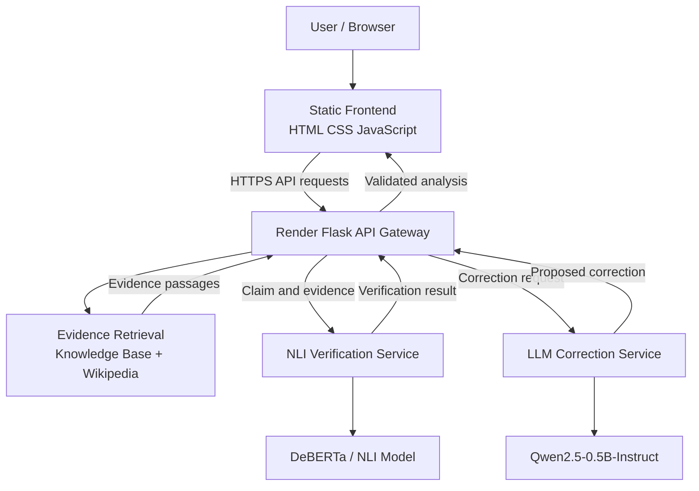

# LLM Hallucination Detection and Correction Framework

A lightweight, evidence-grounded AI framework for detecting hallucinations in AI-generated text, verifying individual factual claims against retrieved evidence, and proposing corrections validated by Natural Language Inference (NLI) models.

The project uses a decoupled architecture that separates the static web frontend, Flask API gateway, NLI verification service, and LLM correction service. It is designed for resource-constrained cloud infrastructure and supports independent deployment of the frontend, backend, and inference services.

> **Deployment status:** The Flask backend is deployed on Render at https://llm-detection-main-a7d0.onrender.com. The frontend is being configured for a separate Render Static Site. EC2 hosts the inference services.

---

## Table of Contents

- [Overview](#overview)
- [Key Features](#key-features)
- [System Architecture](#system-architecture)
- [Technology Stack](#technology-stack)
- [Project Structure](#project-structure)
- [How It Works](#how-it-works)
- [Claim Classification](#claim-classification)
- [Deployment Architecture](#deployment-architecture)
- [API Reference](#api-reference)
- [Configuration](#configuration)
- [Local Development](#local-development)
- [EC2 Inference Services](#ec2-inference-services)
- [Frontend Deployment](#frontend-deployment)
- [Backend Deployment](#backend-deployment)
- [Testing](#testing)
- [Security Considerations](#security-considerations)
- [Troubleshooting](#troubleshooting)
- [Roadmap](#roadmap)
- [License](#license)

---

## Overview

Large Language Models (LLMs) can generate fluent, convincing responses containing inaccurate or unsupported information. This project addresses that problem through evidence retrieval, claim-level verification, and validation-based correction.

Rather than treating an entire paragraph as one statement, the framework decomposes text into individual claims and evaluates each claim against retrieved evidence.

The system is designed around three principles:

1. **Evidence before conclusions:** Retrieve relevant information before classifying factual claims.
2. **Explicit uncertainty:** Distinguish supported and contradicted statements from claims that lack sufficient evidence.
3. **Validated corrections:** Only use corrections when they satisfy the application's validation criteria.

The decoupled deployment uses a lightweight Flask gateway to coordinate evidence retrieval and remote inference services, enabling the computationally intensive components to run separately from the public web application.

## Key Features

### 1. Claim Decomposition

- Splits paragraphs into individual factual claims.
- Preserves abbreviations such as `Dr.` and `U.S.`.
- Handles decimal numbers such as `3.14`.
- Supports bullet lists and structured input.
- Preserves the original paragraph structure where possible.

### 2. Evidence Retrieval

- Searches a local, curated JSON knowledge base.
- Supports exact and fuzzy matching against local facts.
- Retrieves relevant information from the Wikipedia public API.
- Batches related queries and page-extract requests.
- Uses connection pooling and parallel processing to reduce retrieval overhead.

### 3. Natural Language Inference

- Classifies claims against evidence passages.
- Distinguishes entailment, contradiction, and neutral relationships.
- Maps model labels dynamically using the model configuration.
- Uses passage-focused evidence selection to reduce irrelevant context.
- Supports a separately deployed NLI inference service.

### 4. Validated Correction

- Generates proposed corrections for contradicted statements.
- Uses a separately deployed language-model inference service.
- Validates proposed corrections against retrieved evidence.
- Avoids replacing claims when the available evidence does not justify a correction.
- Preserves unverified statements rather than silently deleting them.

### 5. Web Dashboard

- Provides an interface for submitting text for analysis.
- Displays claim classifications, confidence information when available, explanations, and evidence.
- Shows supported, contradicted, and unverified claim statistics.
- Provides visual summaries and comparison charts.
- Displays suggested corrections when available.
- Includes a factual question-and-answer interface.
- Supports analysis history and clearing recent history.
- Reports backend and inference-service availability.

### 6. Decoupled Deployment

- Static HTML, CSS, and JavaScript frontend.
- Flask backend API gateway.
- Independent NLI inference service.
- Independent LLM correction service.
- HTTP-based service integration with configurable endpoints.
- Health checks, request timeouts, and explicit error handling.

---

## System Architecture



### Service responsibilities

| Component | Responsibility |
|---|---|
| Frontend | User interaction, rendering results, charts, and status indicators |
| Flask backend | API handling, evidence orchestration, result aggregation, and service coordination |
| Evidence retrieval | Local knowledge-base matching and Wikipedia retrieval |
| NLI service | Evaluates whether evidence supports or contradicts a claim |
| LLM correction service | Generates proposed corrections for validation |
| EC2 gateway | Exposes authenticated HTTPS endpoints for remote inference |

### Inference endpoints

The EC2 inference gateway is configured at:

`https://13.205.17.228`

Its public routes include:

| Route | Purpose |
|---|---|
| `/nli/health` | NLI service health |
| `/nli/verify` | Verify a claim against evidence |
| `/nli/verify-batch` | Batch claim verification |
| `/llm/health` | LLM correction service health |
| `/llm/correct` | Generate a correction proposal |

These endpoints require authentication using the configured `X-API-Key` header. The underlying inference services listen on private loopback ports `5001` and `5002`.

The HTTPS certificate must be trusted by the calling backend, and its subject alternative name must match the requested IP address or hostname.

---

## Technology Stack

| Layer | Technologies |
|---|---|
| Frontend | HTML5, CSS3, JavaScript |
| Visualization | Chart.js |
| Backend | Python, Flask, Flask-CORS |
| HTTP client | Requests |
| Evidence sources | Local JSON knowledge base, Wikipedia API |
| NLI inference | DeBERTa-based cross-encoder in the original design; separate NLI service in the deployed architecture |
| Correction inference | Local Ollama in the original design; Qwen2.5-0.5B-Instruct in the deployed architecture |
| Model runtime | ONNX Runtime and the configured LLM inference runtime |
| Reverse proxy | Nginx |
| Service management | systemd |
| Cloud infrastructure | AWS EC2 |
| Backend hosting | Render Web Service |
| Frontend hosting | Render Static Site |
| Testing | pytest, JavaScript syntax checks |
| Version control | Git and GitHub |

**Model distinction:** The original local implementation describes `cross-encoder/nli-deberta-v3-small` and Ollama `llama3.2:1b`. The decoupled deployment uses a separately hosted NLI model and Qwen2.5-0.5B-Instruct for correction generation. These configurations are different and should not be treated as interchangeable model identifiers.

---

## Project Structure

The repository contains the original application and its decoupled deployment implementation.

```text
LLM-Detection-Main/
├── app.py
├── requirements.txt
├── requirements-ml.txt
├── knowledge_base.json
│
├── frontend/
│   ├── index.html
│   ├── css/
│   │   └── style.css
│   └── js/
│       └── script.js
│
├── backend/
│   ├── app.py
│   ├── config.py
│   └── services/
│       ├── inference_client.py
│       └── orchestrator.py
│
├── model-services/
│   ├── nli-verification/
│   │   └── app.py
│   └── llm-correction/
│       └── app.py
│
├── services/
│   ├── __init__.py
│   ├── evidence.py
│   ├── verification.py
│   └── correction.py
│
├── static/
│   ├── style.css
│   └── script.js
│
├── templates/
│   └── index.html
│
├── tests/
│   ├── unit/
│   └── integration/
│
├── docs/
│   ├── LIGHTWEIGHT_REDESIGN_PLAN.md
│   ├── LOCAL_FEASIBILITY_REPORT.md
│   ├── PHASE2_MODEL_VALIDATION.md
│   ├── FRONTEND_BACKEND_SYNCHRONIZATION.md
│   └── RENDER_DEPLOYMENT.md
│
├── .env.example
├── .gitignore
└── README.md
```

*Note: This is a logical project layout based on the documented components. Verify the actual repository before assuming every listed file exists.*

---

## How It Works

### Step 1 — Submit text

The user submits a paragraph or factual statement through the frontend.

### Step 2 — Decompose claims

The backend separates the input into individual sentences or factual claims while preserving important formatting and abbreviations.

### Step 3 — Retrieve evidence

The evidence retrieval component searches the local knowledge base and Wikipedia for relevant passages.

### Step 4 — Verify claims

The backend sends claims and evidence to the NLI service. The service evaluates the relationship between each claim and its supporting passage.

### Step 5 — Generate correction proposals

When a claim is contradicted, the correction service can propose an alternative statement based on the available evidence.

### Step 6 — Validate corrections

The system checks proposed corrections against evidence. Unsupported corrections are not treated as validated facts.

### Step 7 — Aggregate results

The backend aggregates the classifications, explanations, evidence references, and validated corrections.

### Step 8 — Display results

The frontend renders claim-level results, summary statistics, correction suggestions, and service availability.

---

## Claim Classification

| Status | Meaning |
|---|---|
| **Supported** | Retrieved evidence supports the claim. |
| **Contradicted** | Retrieved evidence conflicts with the claim. |
| **Unverified** | Evidence is insufficient, unavailable, or does not establish either relationship reliably. |

NLI classification is evidence-relative. A model prediction is not a guarantee of truth, and a lack of contradiction does not prove a claim is factually correct.

Confidence values should be interpreted according to the model and backend implementation; they are not necessarily calibrated probabilities of factual correctness.

---

## Deployment Architecture

The deployment separates the public frontend, backend API, and inference infrastructure.

### Production components

| Component | Deployment |
|---|---|
| Frontend | Render Static Site |
| Backend API | Render Web Service |
| NLI inference | AWS EC2 |
| LLM correction inference | AWS EC2 |
| Inference reverse proxy | Nginx on EC2 |

### Backend URL

`https://llm-detection-api.onrender.com`

### Inference gateway URL

`https://13.205.17.228`

### Frontend API configuration

The frontend controller supports a configurable API base URL through a JavaScript global or HTML meta tag.

Add the following inside the deployed frontend's HTML `<head>`:

```html
<meta
  name="backend-api-url"
  content="https://llm-detection-api.onrender.com"
/>
```

Ensure this configuration appears in the actual HTML file published by Render, before the frontend controller executes.

The JavaScript then sends API requests to the backend rather than the static site's own origin.

No frontend `.env` file is required for this static configuration.

---

## API Reference

All API routes below refer to the Render backend unless otherwise specified.

Base URL:

`https://llm-detection-api.onrender.com`

### 1. Health check

**GET** `/api/health`

Checks backend availability and reports the status of the configured inference services.

Example:

```powershell
Invoke-RestMethod `
  -Uri "https://llm-detection-api.onrender.com/api/health" `
  -Method Get
```

Inspect the returned JSON to determine whether the backend and its inference dependencies are available.

### 2. Analyze text

**POST** `/api/analyze`

Request body:

```json
{
  "text": "The Earth revolves around the Sun. The Moon is made entirely of cheese."
}
```

Example:

```powershell
$body = @{
    text = "The Earth revolves around the Sun."
} | ConvertTo-Json

Invoke-RestMethod `
  -Uri "https://llm-detection-api.onrender.com/api/analyze" `
  -Method Post `
  -ContentType "application/json" `
  -Body $body
```

The response is expected to include claim-level results, classifications, relevant evidence, and correction information where available. Exact response fields depend on the deployed backend implementation.

### 3. Chat assistant

**POST** `/api/chat`

Request body:

```json
{
  "message": "Does the Earth revolve around the Sun?"
}
```

Example:

```powershell
$body = @{
    message = "Does the Earth revolve around the Sun?"
} | ConvertTo-Json

Invoke-RestMethod `
  -Uri "https://llm-detection-api.onrender.com/api/chat" `
  -Method Post `
  -ContentType "application/json" `
  -Body $body
```

### 4. Retrieve analysis history

**GET** `/api/history`

Returns recent analysis history according to the deployed backend's persistence implementation.

```powershell
Invoke-RestMethod `
  -Uri "https://llm-detection-api.onrender.com/api/history" `
  -Method Get
```

### 5. Clear analysis history

**POST** `/api/history/clear`

Example:

```powershell
Invoke-RestMethod `
  -Uri "https://llm-detection-api.onrender.com/api/history/clear" `
  -Method Post `
  -ContentType "application/json" `
  -Body "{}"
```

Use this endpoint only when you intend to clear the applicable history.

---

## Configuration

The backend uses environment-based configuration for deployment-specific settings.

The following names describe the documented inference integration. Confirm the actual variable names in `backend/config.py` and `.env.example` before configuring Render.

| Variable | Purpose |
|---|---|
| `NLI_SERVICE_BASE_URL` | Base URL of the NLI inference gateway |
| `LLM_SERVICE_BASE_URL` | Base URL of the LLM inference gateway |
| `INFERENCE_API_KEY` | Shared authentication credential for inference requests |
| `INFERENCE_CA_BUNDLE_PATH` | Path to a trusted certificate or CA bundle |
| `PORT` | Port supplied by the hosting platform |
| `HOST` | Host interface used by the application, where applicable |

Example values for the deployed inference gateway:

```text
NLI_SERVICE_BASE_URL=https://13.205.17.228
LLM_SERVICE_BASE_URL=https://13.205.17.228
INFERENCE_CA_BUNDLE_PATH=/etc/secrets/ec2_ca.crt
```

Set `INFERENCE_API_KEY` to the configured secret through Render's environment-variable settings. Never commit the actual value to GitHub.

If the certificate is self-signed, configure a suitable Render Secret File containing the public certificate or appropriate CA certificate. Confirm that certificate verification and IP/hostname validation succeed. Do not disable TLS verification.

### Frontend configuration

The frontend requires the backend URL to be configured in the HTML meta tag or through the supported JavaScript global.

Do not place `INFERENCE_API_KEY` or other private credentials in frontend configuration.

---

## Local Development

### Prerequisites

- Python 3.10 or 3.11 recommended for the original ML stack.
- Git.
- Internet access for Wikipedia retrieval and model downloads.
- Optional Ollama installation for the original local correction implementation.

### Clone the repository

```powershell
git clone https://github.com/Jahnavi55561/LLM-Detection-Main.git

cd LLM-Detection-Main
```

### Create a virtual environment

```powershell
py -3.11 -m venv .venv

.\.venv\Scripts\Activate.ps1

python -m pip install --upgrade pip
```

If PowerShell blocks activation:

```powershell
Set-ExecutionPolicy -Scope Process -ExecutionPolicy Bypass

.\.venv\Scripts\Activate.ps1
```

Alternatively, use the environment's Python executable directly.

### Install dependencies

For the core Flask application:

```powershell
pip install -r requirements.txt
```

For the original ML implementation, if its dependencies are required:

```powershell
pip install -r requirements-ml.txt
```

The original ML requirements may be substantially heavier than the decoupled gateway requirements. Avoid installing the complete local model stack on the public backend unless that deployment specifically requires it.

### Run the original application

```powershell
python app.py
```

The original application is documented as available at:

`http://127.0.0.1:5000`

### Run the decoupled backend

For the separated architecture, run the backend entry point with the appropriate environment configuration:

```powershell
python backend/app.py
```

The backend must be able to reach the configured NLI and LLM services. When using the cloud inference gateway, configure the correct URLs, API key, and certificate trust first.

---

## EC2 Inference Services

The inference services are deployed separately from the Render backend.

### NLI verification

- Service port: `5001`
- Local binding: `127.0.0.1:5001`
- Systemd service: `nli-verification.service`
- Purpose: Claim verification against evidence.

### LLM correction

- Service port: `5002`
- Local binding: `127.0.0.1:5002`
- Systemd service: `llm-correction.service`
- Model: Qwen2.5-0.5B-Instruct GGUF
- Purpose: Generate proposed corrections.

### Reverse proxy and authentication

Nginx exposes the authenticated HTTPS gateway on the EC2 public address. The underlying model services should remain private.

Useful checks on EC2:

```bash
sudo systemctl status nli-verification.service
sudo systemctl status llm-correction.service
sudo systemctl status nginx
sudo nginx -t
```

Inspect logs when a service is unavailable:

```bash
sudo journalctl -u nli-verification.service -n 100 --no-pager
sudo journalctl -u llm-correction.service -n 100 --no-pager
sudo journalctl -u nginx -n 100 --no-pager
```

Keep inference ports `5001` and `5002` inaccessible from the public internet. Public access should go through the authenticated HTTPS gateway.

---

## Frontend Deployment

The frontend is a static HTML/CSS/JavaScript application and can be hosted independently of the Flask backend.

### Render Static Site settings

| Setting | Value |
|---|---|
| Repository | `Jahnavi55561/LLM-Detection-Main` |
| Branch | `main` |
| Root Directory | Leave blank |
| Build Command | Leave blank |
| Publish Directory | `frontend`, if this directory contains the production `index.html` |

Confirm the actual entry point before deployment. If the intended homepage is in a different directory, set the publish directory to the correct location.

### Deployment steps

1. Push the frontend changes to the `main` branch.
2. Create a Render Static Site connected to the repository.
3. Configure the publish directory.
4. Deploy the site.
5. Copy the generated Static Site URL.
6. Confirm the backend CORS configuration allows that origin.
7. Test the health check, text analysis, chat, and history functions from the deployed browser.

### Frontend verification checklist

- [ ] Homepage loads over HTTPS.
- [ ] CSS and JavaScript assets load successfully.
- [ ] Backend health status is displayed correctly.
- [ ] Text analysis returns results.
- [ ] Chat requests return a response.
- [ ] Analysis history loads and clears as intended.
- [ ] Browser console has no unresolved CORS or JavaScript errors.
- [ ] Inference services are reported accurately when unavailable.

---

## Backend Deployment

The Flask backend runs as a Render Web Service.

### Recommended service configuration

Use the repository root as the service root when the backend imports packages or reads dependencies from the root directory.

Typical configuration:

| Setting | Value |
|---|---|
| Branch | `main` |
| Root Directory | Blank |
| Build Command | `pip install -r requirements.txt` |
| Start Command | `waitress-serve --host=0.0.0.0 --port=$PORT backend.app:app` |

These commands assume that the root requirements file contains all dependencies needed by the backend, that `backend.app` exposes a Flask application named `app`, and that Waitress is included in the installed dependencies. Verify these assumptions against the actual repository before deploying.

### Environment and secret configuration

Configure the required inference URLs, API key, and trusted certificate through the Render service settings. If a certificate Secret File is used, ensure the configured path matches the file's actual mount path.

### Deployment verification

Check:

`https://llm-detection-api.onrender.com/api/health`

A successful HTTP response confirms that the health endpoint responded; inspect the JSON body to determine the availability of the individual inference services.

---

## Testing

The project includes unit and integration tests for the decoupled architecture.

### Run all tests

```powershell
python -m pytest tests/ -v
```

### Run frontend/backend synchronization tests

```powershell
python -m pytest tests/integration/test_frontend_backend_sync.py -v
```

### Run inference-client tests

```powershell
python -m pytest tests/unit/test_inference_client.py -v
```

### Run the benchmark evaluation

```powershell
python -m pytest tests/integration/test_benchmark_dataset.py -s -v
```

### Validate JavaScript syntax

```powershell
node --check frontend/js/script.js
node --check static/script.js
```

Run only the checks relevant to the files and implementation present in the repository. Some tests may be skipped when they require live model services, hardware, or network access.

A passing unit-test suite does not, by itself, prove that the deployed frontend can reach the backend or that the remote inference models are operational.

---

## Security Considerations

- Keep all API keys and private credentials on the server.
- Do not commit `.env` files containing secrets.
- Use HTTPS for browser-to-backend and backend-to-inference communication.
- Preserve certificate verification; never use `verify=False` in production.
- Restrict CORS to approved frontend origins where practical.
- Keep inference services bound to loopback or private interfaces.
- Require authentication at the public inference gateway.
- Use request timeouts and validate incoming request bodies.
- Avoid returning raw internal exception details to public clients.
- Treat retrieved evidence and model-generated corrections as untrusted input.
- Do not label a claim as factually verified solely because an LLM generated a plausible answer.
- Review the history implementation and retention behavior before storing sensitive user submissions.

---

## Troubleshooting

### Frontend opens but shows the wrong backend status

Check the `backend-api-url` meta tag and confirm that it appears in the actual HTML served by Render.

### Browser reports a CORS error

Check the deployed frontend origin against the Flask CORS configuration. Test from the browser; a successful PowerShell request alone does not prove CORS is configured correctly.

### `/api/health` returns an error

Inspect Render logs and check whether the application started successfully. Confirm the health route exists and that the response is generated by the expected service.

### NLI service is unavailable

Check the NLI systemd service, Nginx logs, inference API key configuration, gateway reachability, and certificate validation.

### LLM correction is unavailable

Check the LLM service logs and health endpoint. A correction-service failure should not be presented as a successful correction.

### HTTPS certificate verification fails

Verify that the certificate is trusted by the backend and that the certificate's subject alternative name matches the requested IP address or hostname. Do not disable certificate verification to bypass the error.

### Static Site build fails

For a plain static frontend, the build command can remain blank. Ensure the publish directory exists in the selected Git branch and contains the intended `index.html`.

---

## Roadmap

- [x] Separate frontend and backend deployment architecture.
- [x] Implement configurable frontend API base URL.
- [x] Integrate remote NLI and LLM inference clients.
- [x] Add inference health checks and explicit service error handling.
- [x] Add unit and integration test coverage.
- [x] Deploy the backend API on Render.
- [ ] Complete the Render Static Site deployment.
- [ ] Verify production frontend-to-backend connectivity.
- [ ] Validate the complete deployed analysis and correction flow.
- [ ] Configure a trusted production TLS certificate for inference endpoints.
- [ ] Add deployment monitoring and operational metrics.
- [ ] Evaluate latency, accuracy, and failure recovery under realistic workloads.

## License

Add the project's chosen license and copyright information before distributing the repository publicly. No specific license is assumed by this README.

---

**Project:** LLM Hallucination Detection and Correction Framework

**Backend:** `https://llm-detection-api.onrender.com`

**Source repository:** `https://github.com/Jahnavi55561/LLM-Detection-Main`
